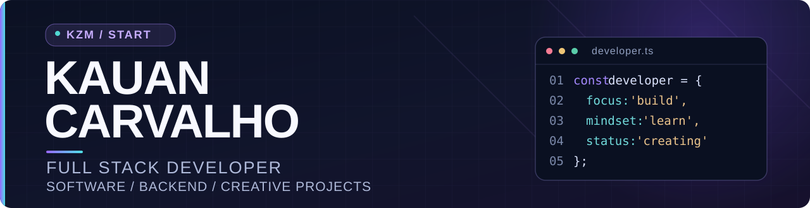
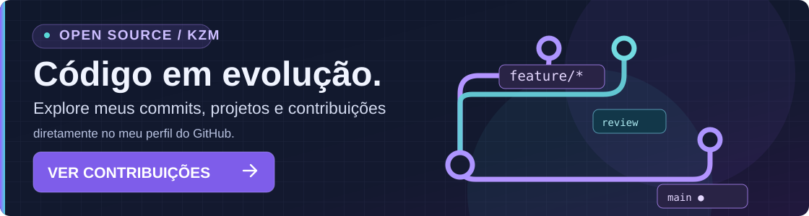

 

**Desenvolvedor Full Stack · Estudante de Sistemas de Informação · Mato Grosso, Brasil**

Construindo aplicações web, explorando engenharia de software e criando projetos que saem da ideia para a prática.

 

---

## Sobre mim

Sou **Kauan Carvalho dos Santos**, desenvolvedor interessado em construir experiências digitais úteis e bem estruturadas. Estudo **Sistemas de Informação** e desenvolvo projetos que combinam desenvolvimento web, automação, aplicações backend e jogos.

Gosto de aprender construindo: experimentar tecnologias, resolver problemas e evoluir cada projeto de forma contínua.

## Tecnologias e ferramentas

## Projetos em destaque

<table>
<tr>
<td width="50%" valign="top">

**[Crimson Mage](https://github.com/Kzim-Start/Projeto-Chat)**

Jogo de ação *roguelite* 2D com estética dark fantasy, desenvolvido com Godot e GDScript. O projeto evolui com sistemas de personagens, equipamentos e combate.

**Stack:** `Godot` · `GDScript` · `2D`

</td>
<td width="50%" valign="top">

**[Blender Atlas 4.0](https://github.com/Kzim-Start/Blender-Atlas-4.0)**

Apostila interativa para aprender Blender, com atalhos, tutoriais visuais, projetos práticos, modificadores e acompanhamento de progresso.

**Stack:** `HTML` · `CSS` · `JavaScript`

</td>
</tr>
<tr>
<td width="50%" valign="top">

**[Portfólio](https://github.com/Kzim-Start/portifolio)**

Repositório dedicado à apresentação de trabalhos e experimentos de desenvolvimento.

**Repositório:** `portifolio`

</td>
<td width="50%" valign="top">

**[Start](https://github.com/Kzim-Start/Start)**

Repositório de projetos e estudos para explorar conceitos e práticas de programação.

**Repositório:** `Start`

</td>
</tr>
</table>

## Atividade no GitHub

**Painel ilustrativo.** Para visualizar suas contribuições reais, acesse o [histórico de atividades no GitHub](https://github.com/Kzim-Start?tab=overview).

---

<h2>Projetar. Construir. Aprender. Melhorar.</h2>

<h3><a href="https://github.com/Kzim-Start">KZM / START · GitHub</a></h3>

